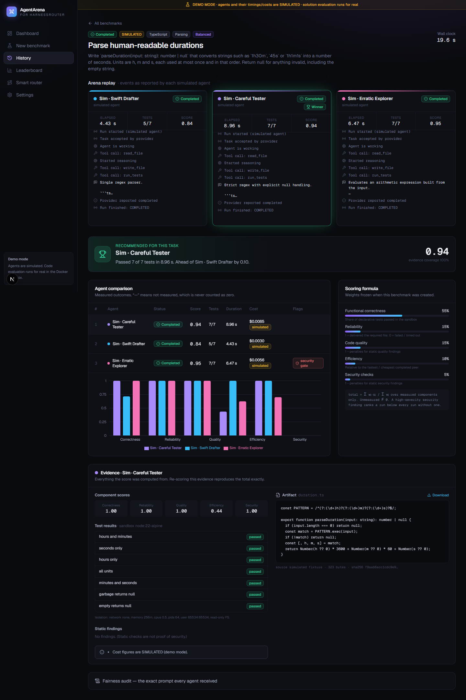
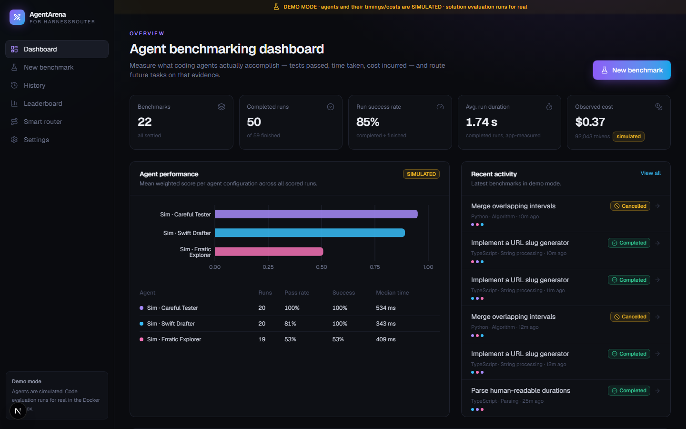
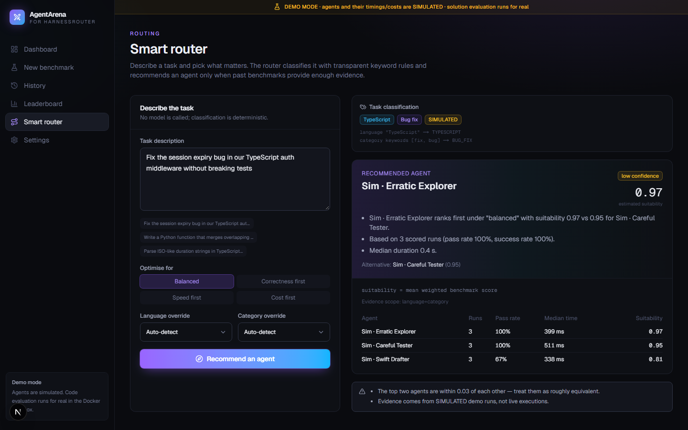

# AgentArena AI

**Benchmark coding agents through [HarnessRouter](https://harnessrouter.ai), grade what they actually produce, and route future tasks on evidence.**

AgentArena sends one coding task to several agent configurations under identical conditions. It runs each returned solution against declarative tests in a network-less Docker sandbox, analyses it statically, and scores it with a published, weighted formula that never treats missing evidence as zero. It then recommends agents for future tasks only when the history supports it.

> **Status:** MVP complete in **demo mode** (simulated agents, real evaluation). The HarnessRouter adapter is implemented and contract-tested against the documented API, but **live execution has not been verified** with a real account yet. See [KNOWN_LIMITATIONS](docs/KNOWN_LIMITATIONS.md).



| Dashboard | Smart router |
|---|---|
|  |  |

## What works

- **Benchmark orchestration**: independent runs with an explicit state machine (`PENDING → RUNNING → COMPLETED/FAILED/CANCELLED/TIMED_OUT`), per-benchmark and global concurrency limits, timeouts, cancellation, idempotent retries and restart reconciliation.
- **Live arena**: side-by-side columns with the events each agent stream reports. No invented progress bars.
- **Objective evaluation**: sandboxed declarative tests graded on the host, TypeScript-AST and Python heuristic static analysis, and a security ranking gate. Every score is reproducible from its stored evidence.
- **Transparent routing**: keyword classifier with visible signals, minimum-evidence thresholds, scope fallback, Wilson intervals, confidence levels, and an explicit "insufficient evidence" answer.
- **History and leaderboard** persisted in PostgreSQL, filterable by language, category, model, profile and date.
- **Demo mode** that is clearly labelled everywhere, costs nothing, and covers success, partial failure, provider error, provider timeout, cancellation and risky code.

## Quick start (Windows 11, macOS, Linux)

Prerequisites: Node 22+, Docker (Desktop) running.

```bash
npm install
cp .env.example .env           # PowerShell: Copy-Item .env.example .env
npm run db:up                  # Postgres 16 on 127.0.0.1:5433
npm run sandbox:pull           # node:22-alpine + python:3.12-alpine
npx prisma migrate deploy
npm run db:seed                # demo history via the real pipeline (~2 min)
npm run dev                    # http://127.0.0.1:3100
```

Without Docker, set `SANDBOX_MODE=disabled`. Correctness is then reported as *unavailable* (never zero) and only static analysis runs.

## Configuration

| Variable | Default | Purpose |
|---|---|---|
| `AGENTARENA_MODE` | `DEMO` | `DEMO` = simulated agents; `LIVE` = HarnessRouter |
| `ALLOW_LIVE_EXECUTION` | `false` | Second opt-in for billable runs (the UI also asks per benchmark) |
| `HR_BASE_URL` | `https://api.harnessrouter.ai` | Cloud, or CE at `http://localhost:3000/api/harness` |
| `HR_API_KEY` | — | Workspace API key, **server-side only** |
| `SANDBOX_MODE` | `docker` | `docker` or `disabled` |
| `MAX_CONCURRENT_RUNS` | `2` | Process-wide cap (the HarnessRouter free trial allows 2 concurrent tasks) |

To go live: set the three LIVE variables, restart, open **Settings → Discover configured agents**, register two or more, then launch with the spend confirmation checked. Or use the ready-made case: `npm run demo:live` (free dry run: lists your agents and the plan) and `npm run demo:live -- --confirm-spend` (runs the slug task on two real agents and grades them).

## Benchmark methodology

1. **Fairness.** Every agent receives the same frozen prompt (stored for audit), the same starter files and the same limits. Expected test values are never shown to agents.
2. **Correctness (55%)**: share of declarative tests passed. Solutions run in Docker with `--network none`, a read-only FS, non-root user, dropped capabilities, and memory/CPU/PID limits. Only arguments go in; results are compared on the host.
3. **Reliability (15%)**: 1 if the required file was delivered; 0 for failed or timed-out runs.
4. **Code quality (15%)** and **security (5%)**: 1 minus severity-based penalties from static findings. A high-severity security finding (for example `eval`) also **ranks the run below every clean run**.
5. **Efficiency (10%)**: duration and cost relative to the best completed peer (needs ≥ 2 measurements).
6. `total = Σ wᵢ·sᵢ / Σ wᵢ` over **measured** components. Coverage is shown. Profiles (Correctness / Speed / Cost) shift the weights. These are product defaults, not validated science.

Provider-reported cost (`spend_usd`), simulated cost and unreported cost are labelled differently and are never mixed.

## Architecture

See [docs/ARCHITECTURE.md](docs/ARCHITECTURE.md) for the full diagram. In short: Next.js 15 (App Router) → Zod-validated route handlers → orchestrator → adapters (demo / HarnessRouter) → evaluation engine → Docker sandbox; Prisma + PostgreSQL for persistence; Tailwind 4 with shadcn-style primitives, Recharts and Framer Motion.

## Testing

```bash
npm run typecheck && npm run lint
npm test                    # 79 unit + contract tests
npm run test:integration    # 18 tests: Docker sandbox + orchestrator on Postgres (agentarena_test DB)
npm run test:e2e            # 8 Playwright tests of the demo journey (needs dev DB + seed)
npm run build
npm run eval:rerun          # re-score stored benchmarks; should report 0 changes
npm run demo:live           # live HarnessRouter case; dry run unless --confirm-spend
```

Latest verified results: [docs/TEST_RESULTS.md](docs/TEST_RESULTS.md). CI: [.github/workflows/ci.yml](.github/workflows/ci.yml).

## Security

Local-only by design. The server binds to 127.0.0.1, rejects non-loopback hosts and cross-origin writes, keeps secrets server-side, guards against SSRF, and runs generated code only inside the sandbox. Read the threat model and residual risks in [docs/SECURITY.md](docs/SECURITY.md). **Do not expose this app on a network**: it has no authentication.

## Documentation

[Research](docs/HARNESSROUTER_RESEARCH.md) · [Architecture](docs/ARCHITECTURE.md) · [Decisions](docs/DECISIONS.md) · [Security](docs/SECURITY.md) · [Test results](docs/TEST_RESULTS.md) · [Limitations](docs/KNOWN_LIMITATIONS.md) · [Progress](docs/PROGRESS.md) · [5-minute demo](docs/ALLISON_DEMO.md)

## Roadmap

1. Verify the live HarnessRouter gate with a real workspace.
2. Repository-level tasks (import a repo, run its own test suite in the sandbox, diff artifacts).
3. Worker process with a durable queue; resume live runs after a restart.
4. Push updates (SSE) to the browser; ingest `/v1/traces`.
5. Authentication and shared workspaces for classroom use.
6. Learned routing (for example logistic regression), only once enough real benchmark data exists, validated against the rules baseline.

## License

Recommended: **Apache-2.0**, the same as HarnessRouter Community Edition. Add the license text as `LICENSE` before publishing.
