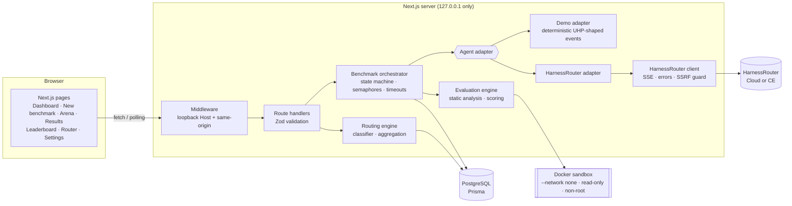

# Architecture

## Components

| Component | Location | Responsibility |
|---|---|---|
| Frontend | `src/app/**`, `src/components/**` | Server components read the DB directly. Client components (arena, forms, router) call the JSON API. The UI polls `/api/benchmarks/:id` once per second while a benchmark is live. |
| Request guard | `src/middleware.ts`, `src/lib/security/request-guard.ts` | Accepts only loopback `Host` headers (blocks DNS rebinding). Mutating API calls must be same-origin (blocks CSRF). |
| API | `src/app/api/**`, `src/lib/api.ts` | Body size limit, Zod parsing, safe error mapping, no stack traces. |
| Orchestrator | `src/lib/orchestrator/orchestrator.ts` | Claims a `PENDING` benchmark atomically. Launches one run per agent under per-benchmark and process-wide semaphores. Enforces timeouts with `AbortController`. Persists events (text deltas throttled to ≤ 2/s), artifacts and terminal states through conditional updates. Retries retryable errors only before the provider accepted the task, reusing the idempotency key. Then evaluates, ranks and finalizes. On first use it reconciles runs orphaned by a previous process. |
| State machine | `src/lib/domain/run-state.ts` | `PENDING → RUNNING → COMPLETED / FAILED / CANCELLED / TIMED_OUT`. Every DB transition is `updateMany where status = from`, so racing actors cannot double-transition. |
| Agent adapters | `src/lib/agents/**` | One interface (`AgentAdapter.run`). The **demo adapter** replays deterministic, UHP-shaped events through the **same normalizer** as the live adapter. The **live adapter** implements upload → stream → poll-recovery → cancel → spend → files. |
| HarnessRouter client | `src/lib/harnessrouter/**` | Typed, tolerant parsing of the documented contract. SSE parser, error normalization, protocol version discovery, base-URL validation, id validation. Download URLs are rebuilt from ids. |
| Evaluation engine | `src/lib/evaluation/**` | Static analysis (TypeScript AST / Python heuristics), sandboxed declarative tests, host-side result comparison, weighted scoring with honest missing-metric handling, a security ranking gate, and an evidence record that reproduces the score. |
| Sandbox | `src/lib/evaluation/sandbox.ts`, `runners.ts` | `docker run` with argv arrays (no shell): `--network none --read-only --cap-drop ALL --security-opt no-new-privileges --user 65534:65534 --memory 256m --cpus 0.5 --pids-limit 64`, a read-only bind mount, a noexec tmpfs, a wall-clock kill and a per-run nonce. |
| Analytics | `src/lib/analytics/**` | Per-agent aggregates: mean score, pass rate, Wilson interval, median duration, cost, failure patterns, low-sample flag. |
| Routing | `src/lib/routing/**` | Keyword classifier with listed signals, then scope fallback (language+category → language → all), minimum-evidence threshold, objective formula, security gate, and confidence from sample size and margin. |
| Persistence | `prisma/schema.prisma` | Workspace, AgentConfiguration, CodingTask, Benchmark, AgentRun, ExecutionEvent, Artifact, EvaluationResult, RoutingRecommendation, SystemConfiguration. |

## A benchmark, end to end

1. `POST /api/benchmarks` validates the input. `createBenchmark` deduplicates the task by content hash, checks that every agent is active, matches the server mode and supports the language, freezes the weights and **the one prompt every agent receives**, and creates one `PENDING` run per agent with its own `Idempotency-Key`.
2. `orchestrator.start` runs in the background. Each run waits for slots, moves to `RUNNING`, and streams normalized events into `ExecutionEvent`.
3. The adapter result maps to a terminal status. A provider `incomplete/timeout` becomes `TIMED_OUT`. Artifacts are validated (safe relative path, ≤ 200 KB) and stored with a sha256.
4. `evaluate` loads every run and calls `evaluateBenchmark`. Efficiency is relative, so it needs the whole benchmark. Results are upserted with full evidence, and the winner is ranked. `finalizeBenchmark` then derives the benchmark status.
5. The browser polls and renders the arena, then the results.

## Execution modes

`AGENTARENA_MODE=DEMO` (default) or `LIVE`. Agents carry a `mode`. A benchmark refuses agents from the other mode, so simulated and live data never mix in analytics or routing. LIVE also requires `ALLOW_LIVE_EXECUTION=true`, an `HR_API_KEY`, and a per-benchmark spend confirmation.

## Conventions

- Strict TypeScript (`noUncheckedIndexedAccess`). Zod at every trust boundary.
- Server-only modules import `server-only`. Client components never import env, db or runtime modules (unit-tested).
- No mock data in live paths. Everything simulated is labelled `SIMULATED` in the data (`mode`, `costSource`, `ArtifactSource`) and in the UI.
